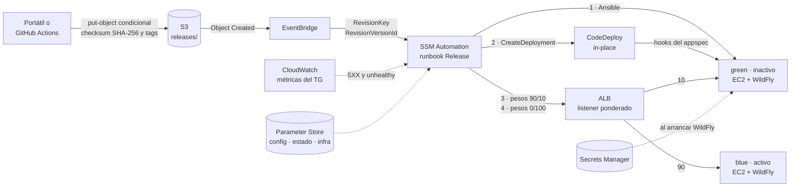
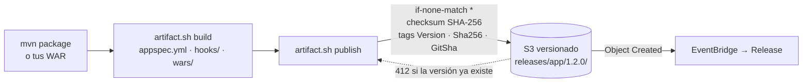
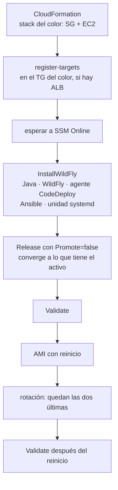
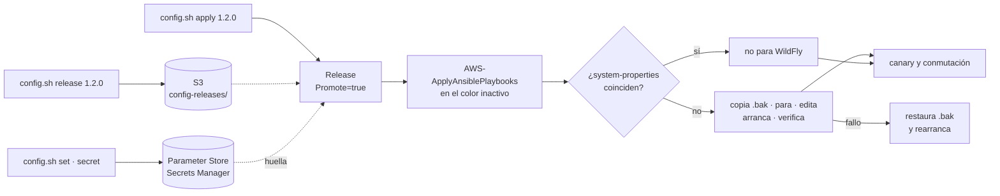
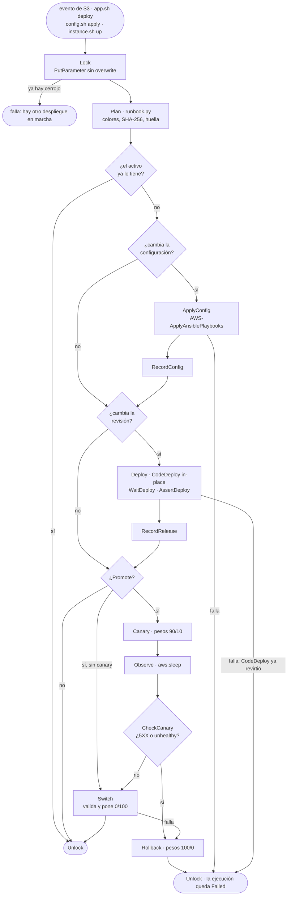
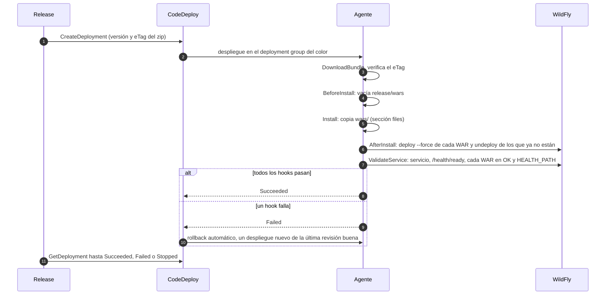
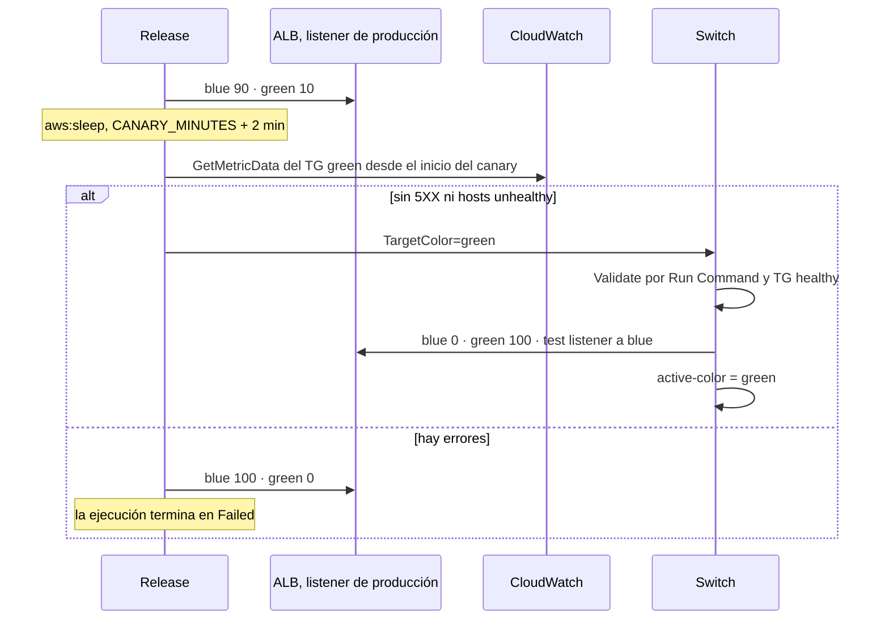

# aws-wildfly-lifecycle

WildFly sobre EC2 con su ciclo de vida completo en AWS. Despliega uno o varios WAR desde S3, con
canary y blue/green por colores. Gestiona la configuración con Ansible, Parameter Store y Secrets
Manager, y hace copias de seguridad de la AMI.

Todo son scripts de bash pequeños sobre la AWS CLI y servicios gestionados de AWS. No hay servidores
de CI propios ni estado local: la verdad vive en AWS. Cada paso también se puede hacer a mano desde
la consola, con los mismos nombres: lo cuenta [docs/manual-consola.md](docs/manual-consola.md).

Publicar un artefacto **es** desplegarlo. El zip llega a S3 y EventBridge arranca un runbook de SSM
Automation. El runbook lleva la release al color inactivo con CodeDeploy, abre un canary con los
pesos del ALB, mira las métricas y conmuta, o vuelve atrás.

## Qué hace

| # | Automatización | Script | Qué hace |
|---|---|---|---|
| 0 | Cimientos | `bin/setup.sh` | bucket, roles, aplicación de CodeDeploy, documentos y runbooks de SSM, rule de EventBridge |
| 1 | ALB (opcional) | `bin/alb.sh` | ALB con dos target groups ponderados (blue y green) y un *test listener* |
| 2 | Artefacto | `bin/artifact.sh` | empaqueta uno o varios WAR con su `appspec.yml` y lo publica en S3, en local o desde GitHub Actions |
| 3 | Instanciación inicial | `bin/instance.sh` | instancia de un color, WildFly instalado por SSM, validación y copia AMI (máximo dos) |
| 4 | Configuración | `bin/config.sh` + `ansible/` | Ansible edita `standalone.xml` con valores de Parameter Store y referencias a Secrets Manager |
| 5 | Aplicación | `bin/app.sh` + EventBridge | S3 → EventBridge → Automation → CodeDeploy, canary por pesos y conmutación |

## Arquitectura



Hay dos colores, cada uno con una instancia y su *deployment group* de CodeDeploy. **Todo cambio
entra por el color inactivo**: una release nueva, una configuración nueva o una instancia nueva. El
color activo solo cambia cuando el inactivo ha pasado la validación y el canary.

## Tecnologías por fase

| Tecnología | 0 · Cimientos | 1 · ALB | 2 · Artefacto | 3 · Instanciación | 4 · Configuración | 5 · Aplicación |
|---|---|---|---|---|---|---|
| CloudFormation | bucket, roles, CodeDeploy, rule | ALB, TGs, listeners | — | SG y EC2 del color | — | — |
| Amazon S3 | bucket versionado y su policy | — | guarda la revisión | WildFly y scripts de plataforma | guarda la release de configuración | origen del evento |
| EventBridge | rule `Object Created` | — | — | — | — | arranca `Release` |
| SSM Automation | registra los runbooks | — | — | converge el color | `Release` | `Release` y `Switch` |
| SSM Run Command | registra los documentos | — | — | `InstallWildFly`, `Validate` | `AWS-ApplyAnsiblePlaybooks` | `Validate` |
| SSM Parameter Store | puntero al color activo | contrato `infra/alb` | — | — | propiedades `app.*` | estado por color y cerrojo |
| Secrets Manager | — | — | — | — | secreto JSON | — |
| CodeDeploy | aplicación y dos deployment groups | — | formato de la revisión | agente 2.x | — | in-place, hooks y rollback |
| Elastic Load Balancing | — | listener ponderado y test listener | — | registro en su TG | — | pesos del canary y conmutación |
| CloudWatch | — | — | — | — | — | métricas del canary |
| EC2, EBS y AMI | — | — | — | instancia y copias AMI | — | — |
| IAM | roles de instancia, Automation, CodeDeploy, EventBridge | — | rol OIDC de GitHub | instance profile | — | — |
| GitHub Actions | — | — | build y publish por OIDC | — | release de configuración | — |
| Maven y Java 21 | — | — | WAR de demo | Corretto 21 | — | — |
| Ansible | — | — | — | se instala con `dnf` | edita `<system-properties>` | — |
| WildFly y `jboss-cli` | — | — | — | instalación y unidad systemd | verificación de la huella | deploy, undeploy y validación |

Bash es el lenguaje de todos los scripts. Python solo aparece en `automation/runbook.py`, porque SSM
Automation no ejecuta bash.

| Fase | La dispara | La orquesta | La ejecuta | La valida | Deja el estado en |
|---|---|---|---|---|---|
| 0 · Cimientos | `setup.sh up` | CloudFormation | CloudFormation | `cloudformation deploy` | stack `-foundation` |
| 1 · ALB | `alb.sh up` | CloudFormation | CloudFormation | health checks de los TGs | `…/infra/alb` |
| 2 · Artefacto | tag `v*` o `artifact.sh` | GitHub Actions o bash | Maven y `zip` | checksum SHA-256 de S3 | clave y tags del objeto |
| 3 · Instanciación | `instance.sh up` | bash | SSM Run Command | `Validate` | `…/state/<color>/*` |
| 4 · Configuración | `config.sh apply` | `Release` | Ansible | `Validate` y canary | `…/state/<color>/config` |
| 5 · Aplicación | evento de S3 o `app.sh deploy` | `Release` | CodeDeploy | `ValidateService` y canary | `…/state/<color>/release` |

## Requisitos

- Una cuenta de AWS y la AWS CLI v2, con permisos para crear los cimientos (IAM, CloudFormation, S3,
  SSM, CodeDeploy, EventBridge).
- Una región donde ya se publique el agente 2.x de CodeDeploy. `setup.sh up` lo comprueba.
- `bash` 4+, `jq`, `zip`, `curl` y `yq` v4 ([mikefarah/yq](https://github.com/mikefarah/yq)). Maven y
  Java 21 solo para construir el WAR de demo.
- Una VPC con dos subnets en dos zonas de disponibilidad. Las instancias necesitan salida a Internet
  (IP pública o NAT) o estos VPC endpoints:
  - el *gateway endpoint* de S3;
  - *interface endpoints* de `ssm`, `ssmmessages`, `ec2messages`, `codedeploy`,
    `codedeploy-commands-secure` y `secretsmanager`.

## Inicio rápido

```bash
cp config/example.env config/dev.env       # VPC, subnets, CIDR permitidos…
bin/setup.sh up                            # cimientos
bin/artifact.sh mirror-wildfly             # WildFly a S3, verificado por SHA-256
bin/alb.sh up                              # opcional; USE_ALB=false para probar sin ALB

bin/config.sh set app.greeting hola
bin/config.sh secret DB_PASSWORD           # lee el valor de stdin, sin eco
bin/config.sh release 1.0.0

bin/instance.sh up blue --config 1.0.0     # el primer color recibe la configuración inicial
bin/instance.sh up green                   # el segundo converge a lo que tiene el activo

bin/artifact.sh build 1.0.0                # sin WAR: construye app/; con WAR: los empaqueta
bin/artifact.sh publish build/wildfly-demo-1.0.0.zip   # publicar es desplegar
bin/app.sh status
```

La primera release no tiene con qué compararse, así que conmuta sin canary. A partir de la
segunda, cada publicación pasa por el canary.

Los scripts leen `config/<ENV_NAME>.env` (por defecto, `dev`). Las variables de entorno ganan, y así
se configura el workflow de GitHub. [`config/example.env`](config/example.env) documenta cada clave.

## El contrato de los artefactos

Los dos artefactos se publican de la misma manera:

- con `s3api put-object --checksum-sha256`: S3 rechaza la subida si los bytes no coinciden;
- con `--if-none-match '*'`: una versión se publica una sola vez, y la bucket policy lo exige;
- con los tags `Version`, `Sha256` y `GitSha`.

El mismo código produce el mismo zip, porque se construye de forma reproducible.

| | Revisión de la aplicación | Release de configuración |
|---|---|---|
| Clave | `releases/<app>/<versión>/<app>-<versión>.zip` | `config-releases/wildfly-config/<versión>/wildfly-config-<versión>.zip` |
| Contenido | `appspec.yml`, `wars/*.war` (uno o varios) y `hooks/` | `site.yml` en la raíz, `vars/`, `collections/` |
| La consume | CodeDeploy (`s3Location` con versión y eTag) | `AWS-ApplyAnsiblePlaybooks` (`SourceType=S3`, `PlaybookFile=site.yml`) |
| Dispara algo | sí: EventBridge arranca `Release` | no: se aplica con `config.sh apply` |
| Se publica con | `artifact.sh publish` · workflow `artifact.yml` en tags `v*` | `config.sh release` · workflow `config-release.yml` en tags `config-v*` |

Reglas del contrato:

- **La versión es semver sin metadatos de build** (`1.4.0`, `1.4.0-rc.1`) y va **siempre en la
  clave**. El tag `Version` la repite, y el runbook comprueba que coinciden.
- **Los tags no son la identidad**: se pueden reescribir y S3 no admite escribirlos de forma
  condicional. Lo que no cambia es el checksum, y el runbook comprueba que el tag `Sha256` coincide
  con él.
- **Los hooks de `hooks/` son obligatorios**: CodeDeploy solo ejecuta scripts que estén dentro de
  la revisión. Son envoltorios de una línea que llaman a los scripts de plataforma instalados en la
  instancia, así que lo que aporta quien despliega son los WAR.
- **La release de configuración es autocontenida**: trae la colección `community.general` dentro, y
  la instancia no necesita Ansible Galaxy. Cualquier otro repositorio puede publicar releases de
  configuración si respeta esta clave y estos tags.

## Las automatizaciones

### 0 · Cimientos · `bin/setup.sh up | render | down`

`setup.sh up` hace estas cosas, en orden:

1. Crea el stack `wfl-<env>-foundation`:
   - el bucket versionado con su policy (solo TLS y escritura condicional en los prefijos de
     release);
   - los roles;
   - la aplicación de CodeDeploy con sus dos deployment groups, uno por color (in-place,
     `CodeDeployDefault.AllAtOnce` y rollback automático);
   - la rule de EventBridge, que solo reacciona a `releases/*.zip`;
   - el rol OIDC de GitHub, si está configurado.
2. Publica los scripts de plataforma.
3. Registra los documentos y los runbooks de SSM.

`render` deja en `build/ssm/` los documentos tal como se registran, para pegarlos en la consola.

S3 tarda unos cinco minutos en entregar eventos a EventBridge después de activar la notificación.

### 1 · ALB · `bin/alb.sh up | down | status | switch <color>`

- **Listener de producción**: `forward` a los dos target groups con pesos relativos (100/0 en
  reposo, 90/10 durante el canary).
- **Test listener** en el puerto 8081: apunta siempre al color inactivo y solo admite
  `ALLOWED_CIDR`.
- **Sin stickiness**: con sesiones pegajosas, el canary repartiría usuarios en vez de peticiones.
- **El contrato `…/infra/alb`**: el stack escribe en Parameter Store un JSON con los ARN que necesitan
  los runbooks. Es lo único que estos leen del ALB, así que un ALB creado a mano también vale.

Sin ALB (`USE_ALB=false`), todo funciona igual, sin canary, y se prueba contra la IP de cada
instancia.

### 2 · Artefacto · `bin/artifact.sh build <versión> [war…] | publish <zip> | mirror-wildfly`



El workflow `artifact.yml` ejecuta los mismos dos comandos. Se lanza con un tag `v1.2.0` o a mano, y
se autentica en AWS por OIDC, sin claves guardadas.

### 3 · Instanciación inicial · `bin/instance.sh up <color> [--from-ami <id|latest>] [--config <versión>]`



- **Sin puertos de administración.** No hay key pair ni SSH, y la consola de gestión de WildFly
  escucha solo en `127.0.0.1`. El acceso es por Session Manager
  (`aws ssm start-session --target <id>`).
- **Los secretos no llegan nunca a disco persistente.** La unidad systemd los lee de Secrets Manager
  al arrancar y los deja en `/run`, que es tmpfs. Por eso ninguna AMI de copia contiene secretos.
- **La copia reinicia la instancia** para que el disco quede consistente. `--from-ami latest`
  levanta un color desde la última copia.

Otros subcomandos: `validate <color>`, `backup <color>`, `down <color> [--force]` y `status`.

### 4 · Configuración · `bin/config.sh set | unset | secret | show | release | apply`



- **Valores.** Cada parámetro `…/config/app.<nombre>` de Parameter Store se convierte en una system
  property de `standalone.xml`.
- **Secretos.** Cada clave del secreto se convierte en `app.secret.<clave>` con el valor
  `${env.<CLAVE>}`. Es una expresión que WildFly resuelve en tiempo de ejecución: el valor nunca se
  escribe en el XML.
- **Huella.** La release, los parámetros y la versión del secreto forman una huella, que también se
  escribe como propiedad. Si la huella del color destino ya coincide, Ansible no hace nada.
- **Rotar un secreto.** Basta con volver a ejecutar `apply` con la misma versión: la huella cambia,
  la propiedad también, y WildFly se reinicia para leer el valor nuevo.

### 5 · Aplicación · S3 → EventBridge → `Release` → CodeDeploy

El runbook `Release` es el mismo para una release de la aplicación, una de configuración y la
convergencia de una instancia nueva. Cambia solo lo que le llega como parámetro.



Dentro de la instancia, CodeDeploy ejecuta los hooks del `appspec.yml`:



Y el canary, con la conmutación o la vuelta atrás:



Lo que conviene saber del canary:

- **La señal es real**: son los health checks del ALB (`UnHealthyHostCount`) y los 5XX del target
  group nuevo bajo tráfico real.
- **Sin tráfico no hay señal.** Con poco tráfico, el 10 % de casi nada no prueba nada. Para una demo,
  `app.sh load <minutos>` genera peticiones. Con `CANARY_MIN_REQUESTS` mayor que cero, un canary sin
  tráfico suficiente falla en vez de pasar en silencio.
- **El margen de dos minutos** de `Observe` existe porque las métricas del ALB llegan con retraso.

Otros subcomandos de `app.sh`:

- **`rollback`**: conmuta al color inactivo, que conserva la release anterior.
- **`status`**: el color activo, los pesos, qué hay en cada color y las últimas ejecuciones.
- **`unlock`**: borra un cerrojo huérfano.

**El despliegue no usa CloudFormation.** Del evento a la conmutación solo intervienen S3,
EventBridge, SSM, CodeDeploy, Elastic Load Balancing y CloudWatch. CloudFormation crea una vez la
infraestructura estática. Como los pesos se mueven fuera de la plantilla, `alb.sh up` lee los pesos
vivos del listener y los pasa como parámetros, y una actualización del stack nunca devuelve el tráfico
al color equivocado.

## Estado

Todo el estado vive en Parameter Store, bajo `/aws-wildfly-lifecycle/<env>/`:

| Parámetro | Contenido |
|---|---|
| `config/app.*` | la configuración de la aplicación |
| `state/active-color` | `blue` o `green` |
| `state/<color>/release` · `state/<color>/config` | lo que hay desplegado en cada color (JSON) |
| `state/lock` | el ID de la ejecución de `Release` que tiene el cerrojo |
| `infra/alb` | los ARN del ALB, sus listeners y sus target groups |

El estado es por color, así que volver atrás solo mueve el puntero `active-color` y los pesos.

## Seguridad

- **Las instancias** no tienen puertos de administración abiertos. Con ALB, solo el SG del ALB llega
  al puerto de la aplicación; sin ALB, solo `ALLOWED_CIDR`. Usan IMDSv2 y un disco EBS cifrado.
- **Los roles son mínimos y separados**:
  - la instancia lee su release, su configuración y su secreto;
  - Automation mueve el tráfico y lanza despliegues;
  - GitHub solo puede escribir releases.
- **Los secretos no viajan**: ni en parámetros de Run Command o Automation, ni en logs, ni en
  `standalone.xml`, ni en una AMI.
- **El bucket** exige TLS y escritura condicional en los prefijos de release, y los roles de
  automatización no pueden borrar versiones.

## Coste

Precios on-demand de `eu-west-1` en USD, consultados el 25 de octubre de 2026 en la AWS Price List
API y en las páginas de precios. Cambian con la región.

| Recurso | Precio | Con ALB y dos colores | Sin ALB, un color |
|---|---|---|---|
| EC2 `t3.micro` | 0,0114 / h | 0,0228 / h | 0,0114 / h |
| IPv4 pública | 0,005 / h por IP | 0,02 / h (dos instancias y dos del ALB) | 0,005 / h |
| Application Load Balancer | 0,0252 / h + 0,008 por LCU-hora | ≈ 0,026 / h en reposo | — |
| EBS gp3, 8 GiB | 0,088 por GB-mes | ≈ 0,002 / h | ≈ 0,001 / h |
| **Total por hora** | | **≈ 0,07 USD** | **≈ 0,017 USD** |

| Por release | Precio | Coste |
|---|---|---|
| SSM Automation | 0,002 por paso + 0,00003 por segundo de `aws:executeScript` | ≈ 0,05 (unos 23 pasos entre `Release` y `Switch`) |
| CodeDeploy en EC2 | sin coste (on-premises: 0,02 por instancia actualizada) | 0 |
| Run Command en EC2 y Parameter Store estándar | sin coste | 0 |
| Evento de S3 en EventBridge | 1 por millón de eventos | ≈ 0 |
| CloudWatch `GetMetricData` | 0,01 por cada 1.000 métricas | ≈ 0 |

| Por mes | Precio |
|---|---|
| Secrets Manager | 0,40 por secreto + 0,05 por cada 10.000 llamadas |
| Snapshots de las dos AMIs | 0,05 por GB-mes (incrementales) |
| S3 | céntimos |

## Por qué así

- **CodeDeploy no hace canary en EC2.** En EC2 solo ofrece in-place y blue/green con
  `AllAtOnce`, `HalfAtATime` y `OneAtATime`, que mueven el tráfico por número de instancias. Las
  configuraciones canary y linear existen solo para Lambda y ECS. Por eso el trabajo se reparte:
  - CodeDeploy despliega y valida en el color inactivo;
  - el ALB reparte el tráfico con pesos;
  - Automation orquesta las dos cosas.
- **`ValidateService` es el último hook.** Si falla, el despliegue falla. El rollback automático de
  CodeDeploy no deshace nada: es un despliegue nuevo de la última revisión buena.
- **Los pesos de un listener son relativos.** 90/10 y 9/1 reparten igual. Los dos target groups
  cuelgan siempre del listener, y los dos tienen health checks.
- **La clave del objeto es la identidad**, porque CodeDeploy y `AWS-ApplyAnsiblePlaybooks`
  seleccionan por ruta. Los tags se pueden reescribir: son un espejo que se verifica.

## Solución de problemas

| Síntoma | Causa probable | Dónde mirar |
|---|---|---|
| `publish` devuelve `412 Precondition Failed` | esa versión ya está publicada | publica otra versión |
| El zip llega a S3 y no arranca `Release` | la notificación a EventBridge se activó hace menos de cinco minutos, o la clave no casa con `releases/*.zip` | `aws events list-targets-by-rule --rule wfl-<env>-release` |
| `Release` falla en `Lock` | otro despliegue en marcha, un evento duplicado (EventBridge entrega *at least once*) o un cerrojo huérfano | `bin/app.sh status` y `bin/app.sh unlock` |
| `Release` falla en `Plan`: «CodeDeploy todavía está desplegando» | el rollback automático del intento anterior sigue en marcha | espera a que acabe: `aws deploy list-deployments --include-only-statuses InProgress …` |
| `Release` falla en `Plan` por el checksum o los tags | el zip no se subió con `artifact.sh publish` | `aws s3api head-object --checksum-mode ENABLED …` |
| CodeDeploy se queda en `InProgress` | el agente está parado o no llega a su endpoint | Session Manager y `systemctl status codedeploy-agent` |
| CodeDeploy falla en `AfterInstall` o `ValidateService` | un WAR que no despliega, o un health check que no responde | `aws deploy get-deployment-instance …` y `/opt/codedeploy-agent/deployment-root/deployment-logs/codedeploy-agent-deployments.log` |
| `CheckCanary` falla | 5XX o hosts unhealthy en el color nuevo, o tráfico por debajo de `CANARY_MIN_REQUESTS` | la salida del paso y las métricas del TG en CloudWatch |
| WildFly no arranca después de `apply` | Ansible restauró la copia `.bak` | `journalctl -u wildfly` en la instancia |
| `instance.sh up` espera a SSM para siempre | sin salida a los endpoints de SSM | `aws ssm describe-instance-information` |

## Limpieza

```bash
bin/destroy.sh               # colores, ALB, AMIs, estado, secreto y cimientos; pide confirmación
bin/destroy.sh --keep-amis   # conserva las copias AMI
```

Al final consulta la tagging API y sale con 1 si queda algo vivo. Las métricas y el historial de
ejecuciones de Automation y de CodeDeploy no se pueden borrar al momento.

## Límites

- Una instancia por color, sin Auto Scaling.
- Un único escalón de canary.
- Una release que llega con el cerrojo tomado falla y hay que relanzarla con `app.sh deploy`: no se
  encola.
- Sin dominio propio: el certificado de `CERTIFICATE_ARN` es opcional.
- Sin creación de VPC ni de NAT, y sin Windows.

## Licencia

[MIT](LICENSE). La release de configuración que se construye incluye la colección
`community.general` de Ansible, que tiene su propia licencia (GPL-3.0) y no forma parte de este
repositorio.
