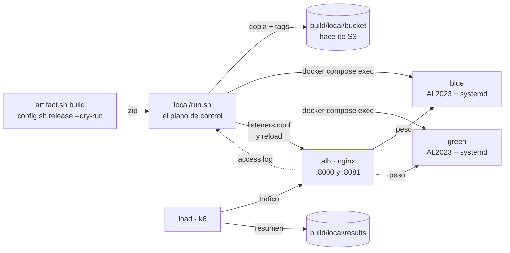
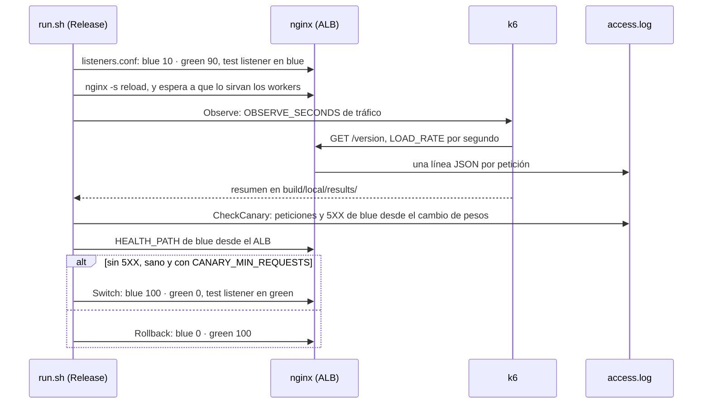

# Desarrollo local

> [!NOTE]
> Probado el **25 de octubre de 2026** en Linux x86_64 con Docker Engine 29.8 y Docker Compose
> v5.5. Los tiempos son los de esa máquina, con la caché vacía.

Esta guía cuenta cómo recorrer en el portátil, con Docker Compose y sin cuenta de AWS, los flujos de
este repositorio: instanciar un color, aplicar configuración, publicar releases, hacer un canary,
conmutar en blue/green, volver atrás y provocar los fallos que el diseño sabe absorber. Dice también
qué parte es idéntica a AWS, qué parte se simula y qué solo se puede probar en una cuenta.

## ¿Se puede probar todo el flujo en local?

Casi todo. Hay dos mitades, y cada una se trata de forma distinta:

- **Lo que corre dentro de una instancia es lo mismo que en AWS.** Los contenedores `blue` y `green`
  son Amazon Linux 2023 con systemd, y en ellos se ejecutan los mismos ficheros: el instalador
  `remote/install-wildfly.sh`, el agente 2.x de CodeDeploy con la revisión y sus hooks, el playbook de
  Ansible de la release de configuración, `fetch-secrets.sh` y `validate.sh`.
- **Lo que en AWS hace un servicio gestionado se imita.** `local/run.sh` hace de plano de control:
  ejecuta los pasos de los runbooks `Release` y `Switch` en el mismo orden y con las mismas
  decisiones. nginx hace de ALB, su access log hace de CloudWatch y unos ficheros de `build/local/`
  hacen de S3, Parameter Store y Secrets Manager.

| En AWS | En local | ¿Igual que en AWS? |
|---|---|---|
| EC2 con Amazon Linux 2023 | contenedor `amazonlinux:2023` con systemd como PID 1 | sí: la misma distribución, los mismos paquetes de `dnf` y la misma unidad `wildfly` |
| documento `InstallWildFly` | `remote/install-wildfly.sh` con las variables `SSM_*` que pone el documento | el mismo script. Las fuentes son `file://` en lugar de S3, y el agente de CodeDeploy entra antes desde el mismo rpm fijado: el instalador lo encuentra con `rpm -q` |
| CodeDeploy in-place | el agente real con `codedeploy-agent deploy-local` | el `appspec.yml`, los hooks y los scripts de plataforma, sí. Lo que aporta el servicio no: el rollback automático lo repite `run.sh`, y las variables `BUNDLE_*` llegan vacías |
| `AWS-ApplyAnsiblePlaybooks` | `ansible-playbook -i localhost, -c local` sobre la release descomprimida | el mismo playbook y la misma colección. Los valores llegan por la costura de pruebas de `site.yml` (`config_values` y `secret_keys`) en vez de leerse de Parameter Store |
| documento `Validate` | `validate.sh` por `docker compose exec` | sí |
| ALB: listener ponderado y test listener | nginx: `split_clients` en el puerto 80 y un segundo puerto, 8081 | el reparto por pesos y el test listener, sí. nginx no tiene health checks activos: `run.sh` pide `HEALTH_PATH` desde el contenedor del ALB |
| CloudWatch: métricas del target group | el access log de nginx, una línea JSON por petición | se cuentan las peticiones y los 5XX del color nuevo desde el cambio de pesos, sin el retraso de las métricas |
| SSM Automation: `Release` y `Switch` | funciones de `run.sh` con los nombres de los pasos | los pasos y las decisiones de `plan`. `automation/runbook.py` no se ejecuta |
| S3 versionado con escritura condicional y tags | `build/local/bucket/`, y un `<clave>.tags.json` junto a cada objeto | la clave como identidad, el 412 de una versión repetida y la comprobación de los tags contra el SHA-256 |
| EventBridge | `publish` arranca `Release` al momento | el disparo. El patrón de la rule y los cinco minutos que tarda S3 en entregar eventos, no |
| Parameter Store: `…/config` y `…/state` | `build/local/parameters.json` y `build/local/state/` | el estado tiene los mismos nombres: `active-color`, `lock`, `<color>/release`, `<color>/config` |
| Secrets Manager | `build/local/secret.json` | la instancia lo lee al arrancar WildFly y lo deja en `/run` (tmpfs), como en AWS. En el portátil está en claro: no pongas secretos reales |
| CloudFormation, IAM, copias AMI, GitHub Actions | — | no se prueban en local (ver [Lo que solo se prueba en AWS](#lo-que-solo-se-prueba-en-aws)) |



## Requisitos

- **Docker Engine con Compose v2.** Los contenedores de las instancias arrancan systemd: necesitan
  `privileged` y los cgroups del host (cgroup v2). Está probado en Linux; en Docker Desktop no.
- `bash` 4+, `jq`, `curl`, `zip` y las coreutils de GNU (`sha256sum`, `date +%N`), como el resto del
  repositorio.
- **Maven y Java 21** para construir el WAR de demo con `bin/artifact.sh build`. Sin ellos, el WAR se
  construye en un contenedor (ver [Construir sin Maven](#construir-sin-maven)).
- Unos 3 GB de RAM libres (dos JVM de WildFly, nginx y k6) y 2 GB de disco.
- Internet la primera vez: `dnf` dentro de los contenedores, WildFly desde GitHub, el rpm del agente
  desde el bucket público `aws-codedeploy-<región>` y `community.general` desde Ansible Galaxy. Todo
  queda en `build/cache/` o en la imagen.
- Los puertos 8000 y 8081 libres, o `LOCAL_HTTP_PORT` y `LOCAL_TEST_PORT`.
- **Ninguna credencial de AWS.**

## Inicio rápido

```bash
export ENV_NAME=local                       # config/local.env: run.sh lo crea desde example.env
local/run.sh up                             # blue y green (aún sin WildFly) y el ALB

local/run.sh set app.greeting hola          # «Parameter Store»
printf 'p4ss\n' | local/run.sh secret DB_PASSWORD   # «Secrets Manager», por stdin
bin/config.sh release 1.0.0 --dry-run       # construye la release de configuración, sin AWS
local/run.sh publish build/config/wildfly-config-1.0.0.zip

local/run.sh instance blue --config 1.0.0   # InstallWildFly y Ansible en el primer color
local/run.sh instance green                 # el segundo converge a lo que tiene el activo

bin/artifact.sh build 1.0.0
local/run.sh publish build/wildfly-demo-1.0.0.zip   # primera release: conmuta sin canary
bin/artifact.sh build 2.0.0
local/run.sh publish build/wildfly-demo-2.0.0.zip   # canary 90/10 con k6, y conmutación

local/run.sh status
curl -i http://localhost:8000/version       # producción; X-Wfl-Color dice qué color respondió
curl http://localhost:8081/version          # test listener: el color inactivo
```

`up` tarda unos 40 segundos la primera vez (construye la imagen) y unos segundos las siguientes; cada
`instance`, entre dos y tres minutos (los paquetes de `dnf` y WildFly); una release sin canary, unos
15 segundos, y una con canary, `OBSERVE_SECONDS` más unos 20 segundos.

`ENV_NAME=local` separa este entorno del que uses en AWS: `run.sh` lo usa por defecto, pero
`bin/artifact.sh` y `bin/config.sh` toman `dev` si no se dice otra cosa, de ahí el `export`.

## El entorno local

```text
local/
├── compose.yml   blue, green, alb y load
├── Dockerfile    la imagen de las instancias: amazonlinux:2023 con systemd, nada más
├── alb.conf      nginx como ALB: listeners, log JSON y cabecera X-Wfl-Color
├── load.js       la prueba de carga de k6 y su resumen
└── run.sh        el plano de control
```

| Servicio | Imagen | Hace de | Puertos |
|---|---|---|---|
| `blue`, `green` | `wfl-local-instance` (`local/Dockerfile`) | las dos instancias EC2. El repositorio se monta en `/repo`, solo lectura | — |
| `alb` | `nginx:1.30.5-alpine` | el ALB: listener de producción y test listener | `8000` → 80 (producción), `8081` → 8081 (test) |
| `load` | `grafana/k6:1.8.1` | el tráfico. Solo con `docker compose run` (perfil `load`) | — |

### `local/run.sh`

| Subcomando | Qué hace | En AWS |
|---|---|---|
| `up` | construye la imagen si no existe, levanta los contenedores y deja el tráfico en el color activo | `setup.sh up` y `alb.sh up` |
| `instance <color> [--config <v>]` | `InstallWildFly`, `Release` con `Promote=false` y `Validate` | `instance.sh up`, sin stack ni copia AMI |
| `validate <color>` | `validate.sh` en el color, con su línea JSON | documento `Validate` |
| `publish <zip> [--no-event]` | escribe el zip una sola vez en el «bucket» con sus tags; una revisión arranca `Release`, salvo con `--no-event` | `artifact.sh publish` o `config.sh release`, y la rule de EventBridge |
| `deploy <v> [--no-promote]` | `Release` con esa revisión | `app.sh deploy`. `--no-promote` es `Promote=false`, que en AWS se lanza desde la consola |
| `apply [<v>]` | `Release` con esa configuración, o la del activo | `config.sh apply` |
| `rollback` | `Switch` al color inactivo, si tiene release | `app.sh rollback` |
| `switch <color>` | `Switch` a ese color | `alb.sh switch` |
| `load [<segundos>]` | k6 contra el listener de producción; deja el resumen en un fichero | `app.sh load` |
| `set`, `unset`, `secret`, `show` | los valores de `…/config` y las claves del secreto | `config.sh` |
| `status` | color activo, cerrojo, pesos, y release, configuración y `/version` de cada color | `app.sh status` |
| `unlock` | borra un cerrojo huérfano | `app.sh unlock` |
| `down` | borra los contenedores y `build/local/` | `destroy.sh` |

### Variables

Las claves de `config/local.env` valen igual que en AWS, y una variable de entorno con el mismo nombre
gana. Las que más se usan aquí son `CANARY_WEIGHT` y `CANARY_MIN_REQUESTS`. Además, solo en local:

| Variable | Por defecto | Uso |
|---|---|---|
| `ENV_NAME` | `local` en `run.sh` | elige `config/<env>.env` |
| `OBSERVE_SECONDS` | `60` | la duración del paso `Observe`. En AWS es `CANARY_MINUTES` + 2 minutos, porque las métricas del ALB llegan tarde; el access log es inmediato |
| `OBSERVE_LOAD` | `true` | `true`: k6 genera tráfico durante `Observe`. `false`: solo espera, y el tráfico lo pones tú |
| `LOAD_RATE` | `20` | peticiones por segundo de k6 |
| `LOCAL_HTTP_PORT`, `LOCAL_TEST_PORT` | `8000`, `8081` | los puertos del ALB en el portátil |

### El estado: `build/local/`

| Fichero | Hace de |
|---|---|
| `bucket/releases/<app>/<v>/<app>-<v>.zip` y `bucket/config-releases/…` | los objetos de S3 |
| `bucket/…/<zip>.tags.json` | sus tags `Version`, `Sha256` y `GitSha` |
| `parameters.json` | `/aws-wildfly-lifecycle/<env>/config/app.*` |
| `secret.json` | el secreto `aws-wildfly-lifecycle/<env>/app` |
| `state/active-color`, `state/lock`, `state/<color>/release`, `state/<color>/config` | `…/state/*` de Parameter Store |
| `state/listeners` | los pesos y el destino del test listener, en JSON |
| `alb/listeners.conf` | la configuración de los listeners que nginx carga |
| `alb/access.log` | las métricas del target group: una línea JSON por petición |
| `results/` | los resúmenes de k6 |

`build/` está en `.gitignore`. `down` borra `build/local/`, pero conserva `build/cache/` (WildFly, el
rpm del agente y `community.general`) y los zips construidos.

## Los flujos, uno a uno

Cada apartado parte de donde deja el anterior, y todos dan por hecho `export ENV_NAME=local`. Los
fragmentos de salida son de una ejecución real, recortados.

### 1 · Instanciar los colores

```bash
local/run.sh instance blue --config 1.0.0
local/run.sh instance green
```

`instance` hace lo que `instance.sh up` después de crear la instancia:

1. instala el rpm fijado del agente de CodeDeploy;
2. ejecuta `remote/install-wildfly.sh` con las variables `SSM_*` del documento `InstallWildFly`:
   Java, WildFly, Ansible, `platform.zip` y la unidad systemd;
3. converge el color con `Release` y `Promote=false`: al primero se le da `--config`, y el segundo
   recibe lo que tenga el activo;
4. ejecuta `Validate`.

```text
run.sh · Plan: target green (active blue) · configuration changes: true · revision changes: false · canary: 0 %
run.sh · ApplyConfig on green: configuration 1.0.0
    "msg": "configuration 1.0.0 fingerprint 29cfbf45ca68: 4 properties applied"
run.sh · Promote=false: green converged; the traffic does not move
{"status":"ok","failed":"","wildfly":"35.0.1.Final","agent":"2.1.2-17389362373",…,"configVersion":"1.0.0",…}
```

Qué observar:

- Volver a lanzar `instance` sobre un color ya instalado no reinicia WildFly: el instalador ve sus
  marcadores, y Ansible ve que la huella ya coincide.
- Sin `--config` y con el activo vacío, el color solo recibe WildFly, como en AWS.
- No hay copia AMI: el contenedor es la instancia. `up` se puede repetir sin perder nada, porque
  construye la imagen solo si no existe. Si Compose llega a recrear un contenedor (por ejemplo, tras
  editar `local/compose.yml`), es una instancia nueva: `up` borra su estado, lo avisa y hay que volver
  a lanzar `instance`. Para empezar de cero, `local/run.sh down` y `up`.

### 2 · Primera release: sin canary

```bash
bin/artifact.sh build 1.0.0
local/run.sh publish build/wildfly-demo-1.0.0.zip
```

`publish` hace de `put-object` con `--if-none-match '*'`, y de la rule de EventBridge: la revisión
llega al bucket y arranca `Release`. Como el color activo todavía no tiene release, no hay con qué
comparar: `plan` pone el canary a 0, CodeDeploy despliega en el color inactivo y `Switch` le da el
100 %.

```text
run.sh · published releases/wildfly-demo/1.0.0/wildfly-demo-1.0.0.zip (sha256 13f2a04d0525…)
run.sh · Object Created → EventBridge → Release
run.sh · Plan: target green (active blue) · configuration changes: false · revision changes: true · canary: 0 %
run.sh · Deploy on green: releases/wildfly-demo/1.0.0/wildfly-demo-1.0.0.zip
  Executing: BeforeInstall
    BeforeInstall succeeded
  …
  Executing: ValidateService
    ValidateService succeeded
Local deployment succeeded.
run.sh · Switch to green: Validate
run.sh · listeners: {"production":{"green":100,"blue":0},"test":"blue"}
run.sh · green is the active color: http://localhost:8000
```

El agente recorre todos los eventos del ciclo de vida in-place, y los del `appspec.yml` ejecutan los
envoltorios de `hooks/`. La salida de cada hook queda en el log del agente (ver
[Dónde mirar](#dónde-mirar)).

### 3 · Release con canary

```bash
bin/artifact.sh build 2.0.0
local/run.sh publish build/wildfly-demo-2.0.0.zip
```

Ahora el activo tiene release, así que `Release` despliega en el color inactivo, abre el canary con
`CANARY_WEIGHT` (10: el 90 % sigue en el activo), observa y decide.



```text
run.sh · Plan: target blue (active green) · configuration changes: false · revision changes: true · canary: 10 %
run.sh · Deploy on blue: releases/wildfly-demo/2.0.0/wildfly-demo-2.0.0.zip
Local deployment succeeded.
run.sh · listeners: {"production":{"blue":10,"green":90},"test":"blue"}
run.sh · Observe: 30 s of k6 traffic
Load test · 2026-10-25T17:30:05.235Z
http://alb/version · 20 req/s · 30s · 601 requests · p95 2.6 ms · max 4 ms

color  version                 responses     share    5XX
blue   wildfly-demo 2.0.0             50     8.3 %      0
green  wildfly-demo 1.0.0            551    91.7 %      0
run.sh · CheckCanary on blue: {"Errors5xx":0,"Unhealthy":0,"Requests":50}
run.sh · Switch to blue: Validate
run.sh · listeners: {"production":{"blue":100,"green":0},"test":"green"}
run.sh · blue is the active color: http://localhost:8000
```

Qué observar:

- **El reparto no es exacto**: con un peso de 10, el color nuevo recibió entre el 6,5 y el 10,9 % de
  las peticiones en las pruebas. nginx elige el color de cada petición por un hash de su
  `request_id`, y el ALB también reparte petición a petición, no por bloques. Con más peticiones, más
  se acerca al 10 %.
- **k6 y `CheckCanary` cuentan lo mismo por dos caminos**: las 50 respuestas de blue que ve k6 son
  las 50 líneas del access log que lee `CheckCanary`.
- **Durante el canary, el test listener apunta al color nuevo**, igual que en AWS:
  `curl localhost:8081/version` devuelve la 2.0.0. Tras la conmutación pasa al color anterior, que es
  el que se usaría para volver atrás.
- Para ver el canary con calma, alarga la ventana y genera tú el tráfico desde otra terminal:

  ```bash
  OBSERVE_LOAD=false OBSERVE_SECONDS=120 local/run.sh deploy <versión>
  while true; do curl -s localhost:8000/version; sleep 0.2; done    # en otra terminal
  ```

### 4 · Un canary que falla

El canary falla si el color nuevo da algún 5XX, si no está sano al final de la ventana o si recibe
menos de `CANARY_MIN_REQUESTS` peticiones. Entonces `Rollback` devuelve el 100 % al color activo y la
release termina con error. El color nuevo conserva lo desplegado: su estado lo dice, y relanzar la
misma release ya no vuelve a desplegar, solo repite el canary.

Para tener un canary que repetir, vuelve antes al color anterior (lo cuenta el apartado 6):

```bash
local/run.sh rollback                # producción a green (1.0.0); blue conserva la 2.0.0
```

**Por falta de tráfico**, la forma determinista de verlo:

```bash
CANARY_MIN_REQUESTS=1000 OBSERVE_SECONDS=10 local/run.sh deploy 2.0.0
```

```text
run.sh · Plan: target blue (active green) · configuration changes: false · revision changes: false · canary: 10 %
run.sh · listeners: {"production":{"blue":10,"green":90},"test":"blue"}
run.sh · Observe: 10 s of k6 traffic
color  version                 responses     share    5XX
blue   wildfly-demo 2.0.0             18     9.0 %      0
green  wildfly-demo 1.0.0            182    91.0 %      0
run.sh · CheckCanary on blue: {"Errors5xx":0,"Unhealthy":0,"Requests":18}
run.sh · listeners: {"production":{"blue":0,"green":100},"test":"blue"}
run.sh · ERROR: the release failed: production is back on green
```

`revision changes: false`: blue ya tenía la 2.0.0 de un intento anterior, así que no se vuelve a
desplegar; solo se repite el canary.

**Rompiendo el color nuevo a mitad del canary.** Lanza otra vez la release y, en otra terminal,
mientras dura `Observe`, para WildFly en blue:

```bash
OBSERVE_SECONDS=30 local/run.sh deploy 2.0.0
docker compose -f local/compose.yml exec blue systemctl stop wildfly    # en otra terminal
```

nginx empieza a devolver 502 en la parte del tráfico que va a blue, k6 los cuenta en la columna 5XX,
`CheckCanary` los ve en el access log y el health check falla:

```text
color  version                 responses     share    5XX
blue   wildfly-demo 2.0.0             40    10.0 %     24
green  wildfly-demo 1.0.0            361    90.0 %      0
run.sh · CheckCanary on blue: {"Errors5xx":24,"Unhealthy":1,"Requests":40}
run.sh · listeners: {"production":{"blue":0,"green":100},"test":"blue"}
run.sh · ERROR: the release failed: production is back on green
```

Los usuarios que fueron a green no vieron nada: solo el 10 % del tráfico, y solo durante la ventana,
pagó el fallo. Después, arréglalo:

```bash
docker compose -f local/compose.yml exec blue systemctl start wildfly
local/run.sh validate blue
```

**Cancelando.** Un Ctrl+C desde que se abre el canary hasta que termina la conmutación hace lo que
`onCancel` en esos pasos del runbook: `Rollback` y la release termina con error. Antes del canary, un
Ctrl+C solo suelta el cerrojo, como `onCancel: step:Unlock`.

### 5 · Un despliegue que falla: `ValidateService` y el rollback de CodeDeploy

Una revisión cuyo único WAR no sirve `HEALTH_PATH` despliega bien, pero no pasa `ValidateService`:

```bash
mkdir -p build/broken && printf 'broken\n' > build/broken/index.html
(cd build/broken && zip -q ../broken.war index.html)
bin/artifact.sh build 9.9.9 build/broken.war
local/run.sh publish build/wildfly-demo-9.9.9.zip
```

```text
run.sh · Deploy on blue: releases/wildfly-demo/9.9.9/wildfly-demo-9.9.9.zip
  Deployment ID: local-8372
    ValidateService failed: hooks/validate-service.sh: Script at specified location: hooks/validate-service.sh run as user root failed with exit code 1
run.sh · WARNING: the deployment failed: automatic rollback, a new deployment of releases/wildfly-demo/3.0.0/wildfly-demo-3.0.0.zip
  Deployment ID: local-9470
Local deployment succeeded.
run.sh · ERROR: Deploy failed on blue; production did not change
```

En esa ejecución la última revisión buena de blue era la 3.0.0; siguiendo esta guía en orden, es la
2.0.0.

Qué observar:

- `AfterInstall` replegó el WAR anterior, porque ya no está en la revisión, y por eso
  `ValidateService` falla en la comprobación `http` tras un minuto de reintentos. El motivo exacto
  está en el log del agente: `validation failed: http`.
- `deploy-local` no hace rollback automático: eso es del servicio CodeDeploy. `run.sh` hace lo mismo
  que haría el servicio, un despliegue nuevo de la última revisión buena del color.
- El tráfico no se ha movido: un despliegue fallido para antes del canary, y el estado del color
  sigue diciendo la release anterior. Si el color necesitaba además la configuración del activo,
  esa parte sí quedó aplicada y registrada (`RecordConfig` va justo después de `ApplyConfig`), igual
  que en AWS.

### 6 · Blue/green

Hay dos colores y todo cambio entra por el inactivo, así que cada release ya es un blue/green. Lo que
cambia es cómo se mueve el tráfico.

**Sin canary**, todo de una vez después de validar:

```bash
CANARY_WEIGHT=0 local/run.sh deploy 2.0.0
```

**A mano, probando antes por el test listener.** `--no-event` guarda la revisión sin arrancar
`Release`, como si la rule estuviese deshabilitada, y `--no-promote` despliega en el color inactivo
sin tocar el tráfico:

```bash
bin/artifact.sh build 3.0.0
local/run.sh publish build/wildfly-demo-3.0.0.zip --no-event
local/run.sh deploy 3.0.0 --no-promote

curl localhost:8000/version          # producción: wildfly-demo 2.0.0
curl localhost:8081/version          # test listener: wildfly-demo 3.0.0, en el color inactivo

local/run.sh switch green            # el «target» que dijo Plan: Validate, health check y 100 %
curl localhost:8000/version          # wildfly-demo 3.0.0
curl localhost:8081/version          # wildfly-demo 2.0.0: el test listener pasa al color anterior
```

**Volver atrás** es solo mover el tráfico: el color inactivo conserva la release anterior.
`rollback` enseña qué tiene cada color, valida el inactivo y le da el 100 %, sin desplegar nada:

```bash
local/run.sh rollback
```

### 7 · Cambiar la configuración y rotar un secreto

```bash
local/run.sh set app.greeting adios
local/run.sh apply                   # la versión de configuración del activo, con la huella nueva
curl localhost:8000/config
```

```text
app.greeting=adios
app.secret.DB_PASSWORD=<secret sha256:e367aef7>
lifecycle.config-fingerprint=894a17640efb6f3e130963b4aad336e602976396a0b3c5041c343ce354e8f854
lifecycle.config-version=1.0.0
```

La huella junta los bytes de la release de configuración, los valores de `…/config` y la versión del
secreto. Al cambiar un valor cambia la huella, así que `apply` con la misma versión no es un no-op:
Ansible edita `<system-properties>` en el color inactivo, con WildFly parado, y después hay canary y
conmutación. Si el color destino también necesita la revisión del activo, `Release` la despliega en
el mismo paso.

Rotar un secreto es lo mismo:

```bash
printf 'nuevo\n' | local/run.sh secret DB_PASSWORD
local/run.sh apply 1.0.0
curl localhost:8000/config | grep DB_PASSWORD     # app.secret.DB_PASSWORD=<secret sha256:…>
```

`/config` nunca enseña el valor, solo los ocho primeros caracteres de su SHA-256, que cambian tras
la rotación (`e367aef7` → `06aac11c` en la prueba). `standalone.xml` guarda `${env.DB_PASSWORD}`, y el valor está solo en
`/run/wildfly/secrets.env`, dentro del contenedor.

Para publicar una configuración nueva (otro playbook, otra colección):

```bash
bin/config.sh release 1.1.0 --dry-run
local/run.sh publish build/config/wildfly-config-1.1.0.zip   # no arranca nada
local/run.sh apply 1.1.0
```

### 8 · Idempotencia: evento duplicado, versión repetida y cerrojo

```bash
local/run.sh deploy 2.0.0                          # si el activo ya la tiene
local/run.sh publish build/wildfly-demo-2.0.0.zip  # una versión ya publicada
```

```text
run.sh · Skip: blue already runs this revision and this configuration
run.sh · ERROR: 412 Precondition Failed: releases/wildfly-demo/2.0.0/wildfly-demo-2.0.0.zip is already published; publish a new version
```

El primero es lo que pasa cuando EventBridge entrega un evento dos veces: `Plan` ve que producción ya
corre exactamente eso y termina sin tocar nada. El segundo es la escritura condicional: una versión
se publica una sola vez.

Dos releases a la vez chocan con el cerrojo, igual que en AWS. La primera tiene que hacer algo (una
que termina en `Skip` suelta el cerrojo en un segundo):

```bash
local/run.sh set app.demo uno
local/run.sh apply &                 # Ansible, canary y conmutación: más de un minuto
sleep 5; local/run.sh deploy 3.0.0   # mientras tanto
```

```text
run.sh · ERROR: the environment is locked by local:<usuario>:<pid>; if it is orphaned: run.sh unlock
```

Mientras dura la primera, `local/run.sh status` enseña quién tiene el cerrojo.

### 9 · Varios WAR en una revisión

```bash
app/build.sh 4.0.0 >/dev/null        # el WAR de demo con su versión en /version
bin/artifact.sh build 4.0.0 app/target/wildfly-demo.war build/broken.war
CANARY_WEIGHT=0 local/run.sh publish build/wildfly-demo-4.0.0.zip
curl localhost:8000/broken/          # broken
```

`AfterInstall` despliega cada WAR de la revisión y repliega los que ya no están. Uno de ellos tiene
que servir `HEALTH_PATH`. Para ver el repliegue, el color que tiene `broken.war` debe recibir una
revisión sin él, y como cada release entra por el color inactivo, eso ocurre dos publicaciones
después:

```bash
for v in 4.0.1 4.0.2; do
  app/build.sh "$v" >/dev/null
  bin/artifact.sh build "$v" app/target/wildfly-demo.war
  CANARY_WEIGHT=0 local/run.sh publish "build/wildfly-demo-${v}.zip"
done
curl -s -o /dev/null -w '%{http_code}\n' localhost:8000/broken/    # 404
```

En el log del agente del color de la 4.0.0 y la 4.0.2:

```text
[local-13518][stdout][deploy-wars.sh] deployed wildfly-demo.war
[local-13518][stdout][deploy-wars.sh] undeployed broken.war
```

## Pruebas de carga con k6

```bash
local/run.sh load 120                # dos minutos contra el listener de producción
LOAD_RATE=50 local/run.sh load 60    # 50 peticiones por segundo
```

El contenedor `load` (`grafana/k6`) ejecuta `local/load.js`:

- una tasa constante de `LOAD_RATE` peticiones por segundo contra `http://alb/version`;
- antes de empezar, pregunta a cada color qué versión sirve;
- cuenta cada respuesta por la cabecera `X-Wfl-Color`, que pone nginx;
- al terminar, escribe el resumen en pantalla y en dos ficheros.

| Fichero | Contenido |
|---|---|
| `build/local/results/load-<fecha>.txt` | el resumen legible |
| `build/local/results/load-<fecha>.json` | lo mismo, para `jq` |
| `build/local/results/canary-<fecha>.{txt,json}` | los de cada paso `Observe` |

```text
Load test · 2026-10-25T17:30:05.235Z
http://alb/version · 20 req/s · 30s · 601 requests · p95 2.6 ms · max 4 ms

color  version                 responses     share    5XX
blue   wildfly-demo 2.0.0             50     8.3 %      0
green  wildfly-demo 1.0.0            551    91.7 %      0
```

```json
{
  "target": "http://alb/version",
  "rate": 20,
  "duration": "30s",
  "start": "2026-10-25T17:30:05.235Z",
  "requests": 601,
  "p95Ms": 2.6,
  "maxMs": 4,
  "colors": {
    "blue": {
      "version": "wildfly-demo 2.0.0",
      "responses": 50,
      "sharePercent": 8.3,
      "errors5xx": 0
    },
    "green": {
      "version": "wildfly-demo 1.0.0",
      "responses": 551,
      "sharePercent": 91.7,
      "errors5xx": 0
    }
  }
}
```

Las versiones se leen al empezar: si una release cae en un color durante la prueba, la columna
`version` no lo refleja. Para comparar ejecuciones:

```bash
jq -r '[.start, .colors.blue.sharePercent, .colors.green.errors5xx] | @tsv' build/local/results/*.json
```

k6 también se puede lanzar directamente:

```bash
docker compose -f local/compose.yml run --rm --user "$(id -u):$(id -g)" \
  --env DURATION=30s --env RATE=10 --env RESULT=/results/mia load
```

## Dónde mirar

Con `alias dc='docker compose -f local/compose.yml'`:

| Qué | Comando |
|---|---|
| estado de todo | `local/run.sh status` |
| qué color responde | `curl -si localhost:8000/version \| grep -E 'X-Wfl-Color\|wildfly'` |
| los pesos que carga nginx | `cat build/local/alb/listeners.conf` |
| el access log, como métricas | `jq -c 'select(.listener == "production") \| [.pool, .status]' build/local/alb/access.log \| sort \| uniq -c` |
| peticiones y 5XX por color | `jq -s 'group_by(.pool) \| map({pool: .[0].pool, n: length, e5xx: map(select(.upstream_status \| test("^5"))) \| length})' build/local/alb/access.log` |
| la validación completa de un color | `local/run.sh validate blue` |
| los hooks de CodeDeploy, con su salida | `dc exec blue tail -n 40 /opt/codedeploy-agent/deployment-root/deployment-logs/codedeploy-agent-deployments.log` |
| WildFly | `dc exec blue journalctl -u wildfly -n 50` |
| las system properties que escribió Ansible | `dc exec blue grep -o '<system-properties>.*</system-properties>' /opt/wildfly/standalone/configuration/standalone.xml` |
| la configuración vista por la aplicación | `curl localhost:8000/config` |
| los deployments según WildFly | `dc exec blue runuser -u wildfly -- /opt/wildfly/bin/jboss-cli.sh --connect --command='deployment-info'` |
| el estado de «Parameter Store» | `tail build/local/state/*/* build/local/state/active-color` |
| una shell en la instancia | `dc exec blue bash` (el equivalente de Session Manager) |

## Construir sin Maven

`bin/artifact.sh build <versión>` llama a Maven. Sin Maven ni Java 21 en el portátil, el WAR se puede
construir en un contenedor y pasarse a `artifact.sh`, que entonces solo empaqueta:

```bash
docker run --rm --user "$(id -u):$(id -g)" -v "$PWD/app:/app" -w /app -e MAVEN_CONFIG=/tmp/.m2 \
  maven:3.9.16-eclipse-temurin-21 \
  mvn -q -Duser.home=/tmp -DskipTests -Dapp.version=2.0.0 clean package
bin/artifact.sh build 2.0.0 app/target/wildfly-demo.war
```

## Lo que solo se prueba en AWS

El entorno local no sustituye a una prueba en una cuenta. Estas piezas solo existen allí:

- **`automation/runbook.py` y los runbooks.** `run.sh` reproduce sus pasos y sus decisiones, pero no
  ejecuta el Python ni el YAML de `ssm/`. Los `allowedPattern` de los parámetros, los `onFailure` y la
  interpolación `ENV_VAR` de los documentos solo los evalúa Systems Manager.
- **IAM y la bucket policy**: que un rol pueda lo que necesita y nada más, y que S3 rechace un
  `PutObject` sin `If-None-Match`.
- **La rule de EventBridge**: su patrón con `wildcard`, el *input transformer* y el retraso de unos
  cinco minutos tras activar las notificaciones del bucket.
- **El servicio CodeDeploy**: los deployment groups por tags, la revisión fijada por versión y eTag,
  el rollback automático real.
- **El ALB y CloudWatch**: health checks activos, métricas con retraso, el `UnHealthyHostCount` como
  máximo de la ventana (aquí es el health check al final de ella), y la diferencia entre los 5XX del
  target y los del propio balanceador (aquí un 502 de nginx cuenta como 5XX del color).
- **CloudFormation y las copias AMI** (`instance.sh backup`, `--from-ami`).
- **Los workflows de GitHub Actions** y su autenticación por OIDC.

Lo que sí se comprueba sin AWS, además de este entorno, es el lint del workflow `lint.yml`:
`shellcheck`, `cfn-lint`, `ansible-playbook --syntax-check`, `ruff` y `actionlint`.

## Problemas frecuentes

| Síntoma | Causa probable | Qué hacer |
|---|---|---|
| `systemd did not start in blue` | el host no da cgroups v2 al contenedor, o Docker no admite contenedores `privileged` | `docker compose -f local/compose.yml logs blue`; prueba en un Linux con cgroup v2 |
| `bind: address already in use` al hacer `up` | los puertos 8000 u 8081 están ocupados | `LOCAL_HTTP_PORT=9000 LOCAL_TEST_PORT=9081 local/run.sh up` (y la misma variable en los comandos siguientes) |
| `502 Bad Gateway` en `:8000` | el color que recibe el tráfico no tiene WildFly, o no tiene release | `local/run.sh status`; `instance` y `publish` |
| `no WildFly on green` | ese color no se ha instanciado, o su contenedor es nuevo | `local/run.sh instance green` |
| `green is a new container: its state is reset` | Compose recreó el contenedor (por ejemplo, tras cambiar `local/compose.yml`): es una instancia nueva | `local/run.sh instance green` |
| `the environment is locked by …` | otra release en marcha, o una que murió sin soltarlo (`kill -9`); con Ctrl+C sí lo suelta | `local/run.sh unlock` cuando nada esté corriendo |
| `nginx refused build/local/alb/listeners.conf` | una edición de `local/alb.conf` que nginx no acepta | `docker compose -f local/compose.yml logs alb`; tras corregirla, `docker compose -f local/compose.yml up -d --force-recreate alb` |
| `ApplyConfig failed` | el playbook falló y restauró la copia `.bak` de `standalone.xml` | la salida de Ansible, y `journalctl -u wildfly` en el color |
| `CheckCanary` con `Requests: 0` | `OBSERVE_LOAD=false` y nadie mandó tráfico | genera tráfico durante `Observe`, o deja `OBSERVE_LOAD=true` |
| k6 no puede escribir en `/results` | `build/local/results/` lo creó Docker como root, por un `docker compose` lanzado antes que `run.sh` | `sudo rm -rf build/local/results` y cualquier subcomando de `run.sh`, que lo vuelve a crear |
| un cambio en `local/Dockerfile` no se nota | `up` construye la imagen solo si no existe | `local/run.sh down`, `docker image rm wfl-local-instance` y `up` |

## Limpieza

```bash
local/run.sh down                     # contenedores, red y build/local/
docker image rm wfl-local-instance    # la imagen de las instancias
rm -rf build/cache                    # WildFly, el rpm del agente y community.general
```

`down` no borra `config/local.env` ni los zips de `build/`.
