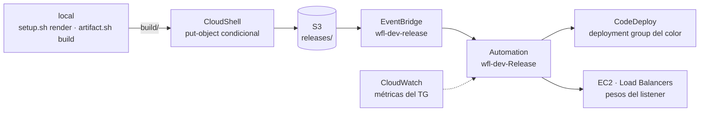

# Manual de consola

> [!NOTE]
> Revisado el **25 de octubre de 2026** con la documentación de AWS de esa fecha. Los menús y
> botones que no se han podido contrastar llevan «verificar en consola». Los ejemplos usan
> `ENV_NAME=dev`, la región `eu-west-1` y `<cuenta>` (tu account ID).

Este manual hace a mano, desde la consola de AWS, lo mismo que los scripts. Usa los mismos nombres y
los mismos tags, así que se puede mezclar: crear el ALB a mano e instanciar con `bin/instance.sh`, o
publicar con el script y seguir el despliegue en la consola. Cada automatización dice qué necesita
antes, los pasos, dónde se comprueba, cómo se deshace y a qué función o paso equivale.



## Antes de empezar

- **La consola no construye.** Tres comandos locales dejan en `build/` lo que se pega o se sube:
  - `bin/setup.sh render`: `build/ssm/*.yml` (los documentos y runbooks con sus valores por
    defecto), `build/events/` (el patrón y el *input transformer* de la rule) y
    `build/platform/platform.zip`. Solo pregunta a AWS quién eres (`sts get-caller-identity`).
  - `bin/artifact.sh build <versión> [war…]`: `build/<app>-<versión>.zip`.
  - `bin/config.sh release <versión> --dry-run`: `build/config/wildfly-config-<versión>.zip`.
- **El botón Upload de S3 no sirve aquí.** La bucket policy deniega `PutObject` sin
  `If-None-Match` en `releases/`, `config-releases/`, `platform/` y `vendor/`, y la consola de S3 no
  envía esa cabecera: la subida acaba en `AccessDenied`. Es a propósito, porque una versión se escribe
  una sola vez. Se sube desde AWS CloudShell, que forma parte de la consola (receta abajo).
- Elige la región en la barra de navegación antes de empezar y no la cambies.

### Nombres y tags

| Qué | Nombre | Tags |
|---|---|---|
| Stack de cimientos | `wfl-dev-foundation` | `Project=aws-wildfly-lifecycle`, `Environment=dev`, `Component=foundation`; los hereda lo que crea |
| Bucket | `wfl-dev-<cuenta>-eu-west-1` | los del stack |
| Roles | `wfl-dev-instance` (y su instance profile), `wfl-dev-codedeploy`, `wfl-dev-automation`, `wfl-dev-events`, `wfl-dev-github` | los del stack |
| CodeDeploy | aplicación `wfl-dev`; deployment groups `wfl-dev-blue` y `wfl-dev-green` | los del stack |
| Rule | `wfl-dev-release` | los del stack |
| Documentos | `wfl-dev-InstallWildFly` y `wfl-dev-Validate` (Command); `wfl-dev-Release` y `wfl-dev-Switch` (Automation) | `Project`, `Environment`, `Component=ssm` |
| Stack del ALB | `wfl-dev-alb`: ALB `wfl-dev`, target groups `wfl-dev-blue` y `wfl-dev-green`, SG `wfl-dev-alb`, listeners 80 (o 443) y 8081 | `Component=alb` |
| Stack de un color | `wfl-dev-blue` o `wfl-dev-green`: SG e instancia `wfl-dev-<color>` | `Component=compute`; `Color=<color>` en la instancia y su SG |
| Parámetros | `/aws-wildfly-lifecycle/dev/config/app.*`, `…/state/active-color`, `…/state/<color>/release`, `…/state/<color>/config`, `…/state/lock`, `…/infra/alb` | `Component=config` en `config/` |
| Secreto | `aws-wildfly-lifecycle/dev/app`, un JSON de claves | `Component=config` |
| AMIs | `wfl-dev-<color>-<AAAAMMDD>T<HHMMSS>Z` | `Component=backup`, `Color`, `WildFlyVersion`, `Release`, `ConfigVersion` |

Las claves de S3 son `releases/<app>/<v>/<app>-<v>.zip`,
`config-releases/wildfly-config/<v>/wildfly-config-<v>.zip`, `platform/<sha256>/platform.zip` y
`vendor/wildfly/<v>/wildfly-<v>.tar.gz`.

**Los tags `Project` y `Environment` de la instancia no son decoración.** El deployment group la
encuentra por ellos (y por `Color`), y el rol de Automation solo puede enviarle comandos si los tiene.

### Receta · subir un artefacto con CloudShell

1. Abre CloudShell con su icono de la barra de navegación.
2. **Actions → Upload file → Browse**, elige el fichero y pulsa **Upload**. Queda en
   `/home/cloudshell-user/`.
3. Publícalo como lo hace `publish_release` (`lib/release.sh`): una sola petición, condicional, con
   el checksum que S3 recalcula y con los tags que `Plan` comprueba.

```bash
f=wildfly-demo-1.0.0.zip
key=releases/wildfly-demo/1.0.0/$f       # la versión es la carpeta de la clave
bucket=wfl-dev-<cuenta>-eu-west-1
hex=$(sha256sum "$f" | cut -d' ' -f1)
aws s3api put-object --bucket "$bucket" --key "$key" --body "$f" \
  --checksum-sha256 "$(openssl dgst -sha256 -binary "$f" | base64)" \
  --if-none-match '*' \
  --tagging "Version=1.0.0&Sha256=${hex}&GitSha=unknown"
```

`412 Precondition Failed` quiere decir que la clave ya existe: publica otra versión. En S3, el
objeto → **Properties** enseña el *Version ID* y el checksum SHA-256, y la sección **Tags** los tres
tags (verificar en consola los nombres de las secciones).

## 0 · Cimientos · `bin/setup.sh up`

**Antes**: `bin/setup.sh render` y permisos de administrador en la cuenta. La VPC aún no hace falta.

**Pasos**

1. **CloudFormation → Stacks → Create stack → With new resources (standard)**. En *Prerequisite -
   Prepare template*, **Choose an existing template**; en *Specify template*, **Upload a template
   file → Choose file** con `templates/foundation.yml`. **Next**.
2. *Stack name* `wfl-dev-foundation`. *Parameters*: `Project=aws-wildfly-lifecycle`, `EnvName=dev`,
   `Prefix=wfl-dev`, `BucketName=wfl-dev-<cuenta>-eu-west-1`, `ParameterRoot=/aws-wildfly-lifecycle/dev`
   y `SecretName=aws-wildfly-lifecycle/dev/app`. `GitHubSubject` va vacío, o con
   `<sub_claim_prefix>:environment:dev` para el rol de GitHub: el prefijo lo da
   `gh api repos/<owner>/<repo>/actions/oidc/customization/sub`. `CreateOidcProvider=false` si la
   cuenta ya tiene el provider `token.actions.githubusercontent.com`. **Next**.
3. *Configure stack options → Tags*: `Project`, `Environment` y `Component=foundation`. En
   *Capabilities*, marca la casilla que acepta que la plantilla cree recursos IAM (con nombre propio:
   verificar en consola el texto). **Next → Submit**.
4. Sube `build/platform/platform.zip` con la receta. La clave es `platform/<sha256>/platform.zip` y
   el tag `Version` es ese mismo SHA-256, que está en el valor por defecto de `PlatformSha256` en
   `build/ssm/install-wildfly.yml`.
5. **Systems Manager → Documents → Create command or session**. *Name* `wfl-dev-InstallWildFly`,
   *Document type* Command; borra el contenido de *Content* y pega `build/ssm/install-wildfly.yml`,
   en formato YAML (verificar en consola el selector de formato). En *Document tags*, los tres tags
   con `Component=ssm`. **Create document**. Repite con `wfl-dev-Validate`.
6. **Documents → Create automation**. *Name* `wfl-dev-Release`; en la pestaña **Editor**, **Edit**,
   pega `build/ssm/release.yml` y pulsa **Create automation**. Repite con `wfl-dev-Switch`. El rol
   `wfl-dev-automation` ya va como valor por defecto de `AutomationAssumeRole`.
7. **Parameter Store → Create parameter**: *Name* `/aws-wildfly-lifecycle/dev/state/active-color`,
   *Parameter tier* Standard, *Type* String, *Value* `blue`. **Create parameter**.
8. Espera unos cinco minutos: es lo que tarda S3 en entregar eventos a EventBridge después de
   activarlos.

**Comprobar**

- CloudFormation: el stack en `CREATE_COMPLETE`, con sus pestañas *Events* y *Outputs*.
- S3 → **General purpose buckets** → el bucket → **Properties** → *Event Notifications* → *Amazon
  EventBridge*: **On**.
- EventBridge → **Rules** → `wfl-dev-release`: activa, con el runbook `wfl-dev-Release` de destino.
- Documents → pestaña **Owned by me**: los cuatro documentos.
- CodeDeploy → **Deploy → Applications** → `wfl-dev`: los dos deployment groups.

**Recurso a recurso, sin CloudFormation.** Si quieres ver cada pieza, la plantilla es la referencia:
las políticas se copian de ella sustituyendo cada `${…}` por su valor.

| Recurso | Consola | Valores |
|---|---|---|
| Bucket | S3 → **Create bucket** | *Object Ownership* Bucket owner enforced, *Block all public access*, *Bucket Versioning* Enable, cifrado SSE-S3; después **Properties → Amazon EventBridge → Edit → On** y **Permissions → Bucket policy → Edit** con `ReleaseBucketPolicy` (verificar en consola) |
| Roles | IAM → **Roles → Create role** → política de confianza propia (verificar en consola) | `AssumeRolePolicyDocument`, `ManagedPolicyArns` y `Policies` de cada rol; el instance profile se llama como su rol |
| Aplicación | CodeDeploy → **Deploy → Applications → Create application** | `wfl-dev`, *Compute platform* EC2/On-premises |
| Deployment groups | la aplicación → pestaña **Deployment groups → Create deployment group** | *Deployment group name* `wfl-dev-blue`; *Service role* `wfl-dev-codedeploy`; *Deployment type* **In-place**; *Environment configuration* **Amazon EC2 instances** con tres tag groups (**Add tag group**): `Project=aws-wildfly-lifecycle`, `Environment=dev`, `Color=blue`; *Agent configuration with Systems Manager* **Never**, porque `InstallWildFly` instala la versión fijada; *Deployment configuration* `CodeDeployDefault.AllAtOnce`; *Load balancer* sin **Enable load balancing**; en **Advanced**, rollback cuando falla el despliegue. **Create deployment group**. Igual con `wfl-dev-green` |
| Rule | EventBridge → **Rules → Create rule → Advanced Builder** | los pasos de abajo |

La rule, con el **Advanced Builder**:

1. *Name* `wfl-dev-release`; *Event bus* **AWS default event bus**; *Rule type* **Rule with an event
   pattern**. **Next**.
2. *Event source* **AWS events or EventBridge partner events**; *Creation method* **Custom pattern
   (JSON editor)**; pega `build/events/release-pattern.json`. **Next**.
3. *Target types* **AWS service**; *Select a target* **Systems Manager Automation**, con el runbook
   `wfl-dev-Release` (verificar en consola los campos de este target). *Execution role* **Use existing
   role** `wfl-dev-events`.
4. **Additional settings → Configure target input → Input transformer → Configure input
   transformer**. *Input path*: `build/events/release-input-paths.json`. *Template*:
   `build/events/release-input-template.txt`. Los marcadores van sin comillas: EventBridge las pone a
   los valores de texto, y cada parámetro de Automation es una lista.
5. **Next → Next → Create rule**.

**Deshacer** (`setup.sh down`): borra los cuatro documentos (el documento → **Actions → Delete**,
verificar en consola); S3 → el bucket → **Empty**, que borra también las versiones (verificar en
consola); y el stack `wfl-dev-foundation` → **Delete**. El parámetro `…/state/active-color` se borra
en Parameter Store.

**Equivale a** `setup.sh up`: `check_agent` · `deploy_foundation` (pasos 1–3) · `render_documents` ·
`publish_platform` (4) · `sync_documents` (5–6) · `init_state` (7). `down`: `delete_documents`,
`empty_bucket` y `delete_stack`.

## 1 · ALB · `bin/alb.sh up`

**Antes**: los cimientos, una VPC con dos subnets en dos zonas de disponibilidad y los CIDR de
`ALLOWED_CIDR` y `ALB_INGRESS_CIDR`. Es opcional: sin ALB todo funciona sin canary.

**Pasos**

1. CloudFormation → **Create stack** con `templates/alb.yml`. *Stack name* `wfl-dev-alb`.
2. *Parameters*: `Prefix=wfl-dev`, `ParameterRoot=/aws-wildfly-lifecycle/dev`, `VpcId`, las dos
   `SubnetIds`, `AppPort=8080`, `HealthPath=/health`, `AlbIngressCidr`, `AllowedCidr`,
   `CertificateArn` (vacío = solo HTTP), `BlueWeight=100`, `GreenWeight=0` y `TestColor=green`.
3. *Tags*: `Project`, `Environment` y `Component=alb`. **Submit**.

**Al actualizarlo**, pasa como parámetros los pesos y el color del test listener que haya en ese
momento: los runbooks los mueven fuera de CloudFormation, y una actualización con los valores de la
plantilla devolvería el tráfico al color equivocado.

**Comprobar**

- *Outputs* del stack: `LoadBalancerDnsName`.
- Parameter Store: `/aws-wildfly-lifecycle/dev/infra/alb`.
- EC2 → **Load Balancing → Target Groups** → `wfl-dev-blue` → **Targets**; y EC2 → **Load
  Balancers** → `wfl-dev` → **Listeners and rules**.

**Deshacer** (`alb.sh down`): primero actualiza cada stack de color con `AlbSecurityGroupId` vacío,
porque su SG referencia el del ALB y este no se podría borrar (stack → **Update**, verificar en
consola). Después borra `wfl-dev-alb`, y con él `…/infra/alb`.

**Equivale a** `alb.sh up` (`live_parameters` y `deploy_stack`), `down` y `status`. `switch` está en
la automatización 5.

### Un ALB que no ha creado este repositorio · `…/infra/alb` a mano

Los runbooks solo leen ese parámetro, así que un ALB propio vale si cumple esto:

- dos target groups de tipo *Instances*, HTTP, en `APP_PORT`, con el health check en `HEALTH_PATH` y
  sin stickiness;
- un listener de producción con **Forward to target groups** a los dos, con pesos (100/0 en
  reposo), y un test listener con *forward* al color inactivo;
- un SG del ALB, que es el que las instancias admitirán en `APP_PORT`;
- **el nombre**: el rol `wfl-dev-automation` solo puede modificar listeners de un ALB llamado
  `wfl-dev` (`elasticloadbalancing:ModifyListener` sobre `listener/app/wfl-dev/*`). Si el tuyo se
  llama de otra forma, añade su ARN a la política `release` del rol, o el canary acabará en
  `AccessDenied`.

| Campo | De dónde sale (EC2 → Load Balancers o Target Groups) |
|---|---|
| `loadBalancer` | el final del ARN del ALB, desde `app/`: `app/<nombre>/<id>` |
| `productionListenerArn` · `testListenerArn` | **Listeners and rules** → el texto de *Protocol:Port* → el ARN del listener |
| `albSecurityGroupId` | el ALB → pestaña de seguridad (verificar en consola) |
| `targetGroups.<color>.arn` | el target group → *Details* → ARN |
| `targetGroups.<color>.dimension` | el final del ARN del target group: `targetgroup/<nombre>/<id>` |

**Parameter Store → Create parameter**: *Name* `/aws-wildfly-lifecycle/dev/infra/alb`, Standard,
String, y este valor:

```json
{"loadBalancer": "app/wfl-dev/0123456789abcdef",
 "productionListenerArn": "arn:aws:elasticloadbalancing:eu-west-1:<cuenta>:listener/app/wfl-dev/0123456789abcdef/1111111111111111",
 "testListenerArn": "arn:aws:elasticloadbalancing:eu-west-1:<cuenta>:listener/app/wfl-dev/0123456789abcdef/2222222222222222",
 "albSecurityGroupId": "sg-0123456789abcdef0",
 "targetGroups": {
   "blue": {"arn": "arn:aws:elasticloadbalancing:eu-west-1:<cuenta>:targetgroup/wfl-dev-blue/3333333333333333",
            "dimension": "targetgroup/wfl-dev-blue/3333333333333333"},
   "green": {"arn": "arn:aws:elasticloadbalancing:eu-west-1:<cuenta>:targetgroup/wfl-dev-green/4444444444444444",
             "dimension": "targetgroup/wfl-dev-green/4444444444444444"}}}
```

**Equivale a** el recurso `InfraParameter` de `templates/alb.yml`. Lo leen `infra_alb`
(`lib/ssm.sh`) y `context` (`automation/runbook.py`).

### Mover los pesos a mano

1. Parameter Store: comprueba que no existe `…/state/lock`, porque una `Release` en marcha también
   mueve los pesos. Para que no llegue ninguna mientras trabajas, créalo con el valor
   `manual:<tu nombre>` y bórralo al terminar: la `Release` que llegue fallará en `Lock` sin tocar
   nada.
2. EC2 → **Load Balancers** → `wfl-dev` → **Listeners and rules** → el texto `HTTP:80` de la columna
   *Protocol:Port*. En la pestaña **Rules**, sección *Listener rules*, selecciona la regla por defecto
   y pulsa **Actions → Edit rule**. En *Default action*, deja **los dos** target groups y cambia los
   pesos, por ejemplo 0 y 100. Guarda (verificar en consola el botón).
3. Igual con el listener `HTTP:8081`: que apunte al color que queda inactivo.
4. Parameter Store → `…/state/active-color` → **Edit**: el color que tiene el peso mayor.

`Plan` lee el listener: el color activo es el target group con más peso. Si `active-color` dice otra
cosa, sigue al listener y lo avisa en su salida `Warnings`. Los pesos son relativos: 90/10 y 9/1
reparten igual. No quites el target group inactivo del listener: los runbooks esperan los dos.

**Equivale a** `shift_traffic` (`automation/runbook.py`) y los pasos `Shift` y `SetActive` de
`wfl-dev-Switch`.

## 2 · Artefacto · `bin/artifact.sh`

**Antes**: los cimientos, y tus WAR o el `app/` de demo.

**Pasos**

1. En local, `bin/artifact.sh build 1.0.0` (o con tus WAR detrás). Deja
   `build/wildfly-demo-1.0.0.zip`, con `appspec.yml`, `hooks/` y `wars/`.
2. Súbelo con la receta a `releases/wildfly-demo/1.0.0/wildfly-demo-1.0.0.zip`. **Publicar es
   desplegar**: en cuanto el objeto existe, la rule arranca `wfl-dev-Release` (automatización 5).
3. **WildFly en S3**, una vez por versión. En CloudShell:

```bash
v=35.0.1.Final
curl -fLO "https://github.com/wildfly/wildfly/releases/download/${v}/wildfly-${v}.tar.gz"
sha256sum "wildfly-${v}.tar.gz"           # tiene que dar WILDFLY_SHA256
aws s3api put-object --bucket wfl-dev-<cuenta>-eu-west-1 \
  --key "vendor/wildfly/${v}/wildfly-${v}.tar.gz" --body "wildfly-${v}.tar.gz" \
  --checksum-sha256 "$(openssl dgst -sha256 -binary "wildfly-${v}.tar.gz" | base64)" \
  --if-none-match '*'
```

**Comprobar**

- S3 → el objeto → **Properties**: el *Version ID*, el checksum y los tags.
- EventBridge → **Rules** → `wfl-dev-release` → sus métricas (verificar en consola la pestaña):
  `Invocations` sube con cada zip; `FailedInvocations` mayor que cero apunta al rol `wfl-dev-events`
  o al destino.
- Systems Manager → **Automation**: una ejecución nueva de `wfl-dev-Release`.

**Deshacer**: una versión publicada no se retira, se publica otra. Si la ejecución que ha arrancado
no debe seguir, deténla desde su página (verificar en consola el botón): antes de `Canary` libera el
cerrojo, y desde `Canary` devuelve los pesos.

**Equivale a** `build` (`check_build_args` y `build_zip`), `publish` (`publish_release`) y
`mirror-wildfly` (`mirror_wildfly`). El workflow `artifact.yml` ejecuta los mismos dos comandos.

## 3 · Instanciación inicial · `bin/instance.sh up <color>`

**Antes**: los cimientos, los cuatro documentos, WildFly en `vendor/` y, si hay ALB, `…/infra/alb`.
El primer color recibe la configuración inicial, así que publica antes una release de configuración
(automatización 4).

**Pasos**

1. CloudFormation → **Create stack** con `templates/instance.yml`. *Stack name* `wfl-dev-blue`.
2. *Parameters*: `Prefix=wfl-dev`, `Color=blue`, `InstanceType`, `VpcId`, `SubnetId` (blue en la
   primera subnet y green en la segunda), `AssignPublicIp`, `InstanceProfileName=wfl-dev-instance`,
   `AppPort=8080`, `AllowedCidr` y `AlbSecurityGroupId` (el `albSecurityGroupId` de `…/infra/alb`;
   vacío sin ALB). `AmiId` es la AMI de Amazon Linux 2023 del parámetro público
   `/aws/service/ami-amazon-linux-latest/al2023-ami-kernel-default-x86_64` (en CloudShell:
   `aws ssm get-parameter --name <ese nombre> --query Parameter.Value --output text`), o una copia
   de `Component=backup`.
3. *Tags*: `Project=aws-wildfly-lifecycle`, `Environment=dev` y `Component=compute`. **Submit**.
4. Con ALB: EC2 → **Target Groups** → `wfl-dev-blue` → **Targets → Register targets**. Selecciona la
   instancia, puerto `8080`, **Include as pending below** y registra (verificar en consola el botón).
5. Systems Manager → **Fleet Manager**: espera a que la instancia aparezca como nodo gestionado y en
   línea (verificar en consola las columnas).
6. **Run Command → Run command**. *Command document* `wfl-dev-InstallWildFly`; *Command parameters*,
   los valores por defecto; *Targets*, la instancia, elegida a mano; **Run**. Tarda unos minutos.
7. Si hay algo a lo que converger: **Automation → Execute automation** → `wfl-dev-Release` →
   **Next** → **Simple execution**. *Input parameters*: `TargetColor=blue`, `Promote=false` y, en
   el primer color, `ConfigVersion=<versión>`; en el segundo, vacío, para tomar la del activo.
   **Execute** y espera a `Success`.
8. **Run Command** con `wfl-dev-Validate` en la misma instancia. La salida acaba en una línea JSON con
   `"status":"ok"` (el comando → la instancia → su salida; verificar en consola).
9. **La copia AMI**, mejor sobre el color inactivo, porque reinicia la instancia. EC2 →
   **Instances** → la instancia → **Actions → Image and templates → Create image**. *Image name*
   `wfl-dev-blue-20261025T120000Z`; deja marcado **Reboot instance**; en *Tags*, **Tag image and
   snapshots together** con `Project`, `Environment`, `Component=backup`, `Color=blue`,
   `WildFlyVersion`, `Release` y `ConfigVersion` (las versiones de `…/state/blue/*`, o `none`).
   **Create image**, y espera en **AMIs** (filtro *Owned by me*) a que esté `available`.
10. **Rotación**: en **AMIs**, de las que tienen `Component=backup` quedan las `AMI_BACKUPS_KEEP`
    más nuevas (dos). Las demás se desregistran con **Actions → Deregister AMI**, y sus snapshots se
    borran en **Snapshots**, donde la descripción lleva el ID de la AMI (verificar en consola si el
    diálogo ofrece borrarlas a la vez).
11. Repite el paso 8: la validación después del reinicio.

**Comprobar**

- Parameter Store: `…/state/blue/release` y `…/state/blue/config`.
- El target group: el destino `healthy` en cuanto hay una release (el health check pide
  `HEALTH_PATH`, que sirve un WAR).
- Una shell en la instancia: EC2 → la instancia → **Connect** → Session Manager (verificar en
  consola), y `systemctl status wildfly` o `cat /etc/wildfly-lifecycle/instance.env`.

**Deshacer** (`instance.sh down`): nunca el color activo, que lleva el tráfico. Desregistra la
instancia de su target group, borra el stack `wfl-dev-blue` y los parámetros `…/state/blue/release`
y `…/state/blue/config`. Las AMIs se quedan.

**Equivale a** `up`: `refuse_active` · `ensure_stack` (1–3) · `register_target` (4) · `wait_online`
(5) · `run_document InstallWildFly` (6) · `converge` (7) · `validate` (8) · `backup`, con
`create_backup` y `rotate_backups` (9–10) · `validate` (11). `--from-ami` es el paso 2 con una copia.
También `validate`, `backup`, `down` y `status`.

## 4 · Configuración · `bin/config.sh`

**Antes**: los cimientos y una instancia con `InstallWildFly`.

**Pasos**

1. **Valores**. Parameter Store → **Create parameter**: *Name*
   `/aws-wildfly-lifecycle/dev/config/app.greeting`, Standard, String, *Data type* `text`, un valor
   de una sola línea de hasta 4.096 caracteres, y los tags con `Component=config`. Para cambiarlo,
   el parámetro → **Edit**; para quitarlo, **Delete**.
2. **Secretos**. Secrets Manager → **Store a new secret** → *Secret type* **Other type of secret** →
   *Key/value pairs*, por ejemplo `DB_PASSWORD`. Las claves van en mayúsculas (`[A-Z][A-Z0-9_]*`) y
   los valores en una sola línea, porque el `EnvironmentFile` de systemd no admite saltos.
   *Encryption key* `aws/secretsmanager` → **Next**. *Secret name* `aws-wildfly-lifecycle/dev/app`,
   tags → **Next** → sin rotación → **Next** → **Store**. Para cambiar un valor, el secreto →
   recupera el valor y edítalo (verificar en consola).
3. **La release de configuración**. En local, `bin/config.sh release 1.0.0 --dry-run`. Sube
   `build/config/wildfly-config-1.0.0.zip` con la receta a
   `config-releases/wildfly-config/1.0.0/wildfly-config-1.0.0.zip`, con `Version=1.0.0`. Publicarla
   no la aplica.
4. **Aplicar**. **Automation → Execute automation** → `wfl-dev-Release` → *Input parameters*:
   `ConfigVersion=1.0.0` y `Promote=true`, el resto vacío. **Execute**. Entra por el color inactivo:
   Ansible, y después canary y conmutación. Para que WildFly lea un secreto rotado, aplica otra vez la
   misma versión: la huella incluye la versión `AWSCURRENT` del secreto, así que cambia.

**Comprobar**

- La ejecución → el paso `ApplyConfig` → la salida de Run Command, con el `PLAY RECAP` de Ansible.
- Parameter Store: `…/state/<color>/config`, con `version` y `fingerprint`.
- La demo: `http://<dns del ALB>/config` enseña las propiedades `app.*`, y el secreto solo como
  huella. En `standalone.xml`, dentro de `<system-properties>`, el secreto es `${env.DB_PASSWORD}`:
  el valor nunca se escribe.

**Deshacer**: aplica la versión anterior (paso 4) o vuelve al otro color (automatización 5), que
conserva la configuración anterior.

**Equivale a** `set` y `unset` (`set_parameter`), `secret` (`set_secret`), `show`, `release`
(`stage_collection`, `build_zip` y `publish_release`) y `apply` (`Release` con `ConfigVersion` y
`Promote=true`). El workflow `config-release.yml` hace el paso 3.

## 5 · Aplicación · S3 → EventBridge → `Release`

**Antes**: todo lo anterior. Para un canary, dos colores y el ALB.

### Lanzar `Release` a mano, como EventBridge

1. S3 → el bucket → `releases/wildfly-demo/1.2.0/` → el objeto → **Properties**: copia el *Version
   ID*.
2. Systems Manager → **Automation → Execute automation** → pestaña **Owned by me** →
   `wfl-dev-Release`. *Document version*, **Default version at runtime**. **Next**.
3. **Simple execution**. En *Input parameters*:
   - `RevisionKey`: la clave del zip; `RevisionVersionId`: el *Version ID* (vacío = la actual).
   - `ConfigVersion` y `TargetColor` vacíos: la configuración del activo y el color inactivo.
   - `Promote=true`; `CanaryWeight=10` (0 = sin canary).
   - `AutomationAssumeRole` y los derivados (`Region`, `Bucket`, `ParameterRoot`…) como vienen.
4. **Execute**.

EventBridge envía solo `{"RevisionKey": [<clave>], "RevisionVersionId": [<versión>]}`; el resto son
los valores por defecto del documento.

En la página de la ejecución, cada paso tiene su estado y sus salidas (verificar en consola dónde):

- `Lock`: si falla, otra ejecución tiene el cerrojo;
- `Plan`: `TargetColor`, `ActiveColor` y `Warnings`;
- `Deploy`: `DeploymentId`, el despliegue de CodeDeploy;
- `Canary`: `StartTime`, el inicio de la ventana;
- `Observe`: espera `CANARY_MINUTES` más dos minutos;
- `CheckCanary`: `Errors5xx`, `Unhealthy` y `Requests`;
- `Switch`: abre una ejecución hija de `wfl-dev-Switch`.

Un fallo antes de `Canary` va a `Unlock`; desde `Canary`, a `Rollback`, que devuelve los pesos al
activo. En los dos casos la ejecución termina en `Failed`.

### Seguir un despliegue en CodeDeploy, evento a evento

1. CodeDeploy → **Deploy → Deployments** → el ID (el `DeploymentId` de `Deploy`; su descripción es
   el ID de la ejecución de Automation).
2. En **Instance activity**, la columna *Events* → **View events**. Los eventos, en orden:
   - `ApplicationStop` y `DownloadBundle`: el agente baja el zip y verifica su eTag;
   - `BeforeInstall`: `deploy-wars.sh --clean` vacía `release/wars`, para que no sobreviva un WAR que
     ya no está en la revisión;
   - `Install`: la sección `files` copia `wars/`;
   - `AfterInstall`: `deploy-wars.sh` hace `deploy --force` de cada WAR y `undeploy` de los que ya no
     están;
   - `ApplicationStart`, sin nada que hacer;
   - `ValidateService`: `validate.sh` (servicio, `/health/ready`, cada WAR en `OK` y `HEALTH_PATH`).

   Los eventos de tráfico (`BlockTraffic`, `AllowTraffic` y sus *Before*/*After*) pasan en vacío: el
   deployment group no tiene balanceador, y el tráfico lo mueve `Release`.
3. Si un evento sale `Failed`, **View logs** enseña la salida del hook (por ejemplo,
   `validation failed: http` y la línea JSON de `validate.sh`). El log completo está en la instancia,
   en `/opt/codedeploy-agent/deployment-root/deployment-logs/codedeploy-agent-deployments.log`.
4. Tras un fallo, CodeDeploy lanza un despliegue nuevo de la última revisión buena: es el rollback
   automático, y aparece como otro despliegue en la lista. Mientras dura, el `Plan` de la siguiente
   `Release` falla con «CodeDeploy is still deploying or rolling back».

### Leer las métricas del canary en CloudWatch

1. CloudWatch → **Metrics → All metrics** → pestaña **Browse** → **ApplicationELB** → **Per AppELB,
   per TG Metrics**. Busca `wfl-dev-green`, o el color que recibe el canary.
2. Marca `HTTPCode_Target_5XX_Count`, `UnHealthyHostCount` y `RequestCount`.
3. En **Graphed metrics**: *Statistic* `Sum`, `Maximum` y `Sum`; *Period* 1 minuto.
4. Rango de tiempo personalizado: desde el `StartTime` de `Canary` (UTC) hasta el final de
   `Observe`.

Se leen como `CheckCanary`: cualquier 5XX en la ventana, o un `UnHealthyHostCount` máximo mayor que
cero, hace fallar el canary, y también un `RequestCount` total por debajo de
`CANARY_MIN_REQUESTS`. El ALB solo publica métricas cuando pasan peticiones, y los health checks no
cuentan: un gráfico vacío es falta de tráfico, no ausencia de errores. Las métricas llegan con
retraso, y por eso `Observe` espera dos minutos de más. Los mismos gráficos están en EC2 →
**Target Groups** → el target group → **Monitoring**.

### Volver atrás, estado y cerrojo

- **Volver atrás** (`app.sh rollback`): comprueba en Parameter Store que el color inactivo tiene
  `…/state/<color>/release`, y toma el cerrojo como al mover los pesos (automatización 1).
  Después, **Execute automation** → `wfl-dev-Switch` →
  `TargetColor=<inactivo>` → **Execute**. Valida por Run Command, espera el target group `healthy`,
  pone 0/100, lleva el test listener al otro color y actualiza `active-color`.
- **Estado** (`app.sh status`): Parameter Store filtrado por `/aws-wildfly-lifecycle/dev/state/`,
  las ejecuciones de **Automation** y los pesos del listener.
- **Cerrojo huérfano** (`app.sh unlock`): `…/state/lock` guarda el ID de una ejecución. Si esa
  ejecución ya no está en curso, borra el parámetro.
- **Tráfico para una demo** (`app.sh load`), desde CloudShell:

```bash
end=$((SECONDS + 300))
while [ "$SECONDS" -lt "$end" ]; do curl -s -o /dev/null "http://<dns del ALB>/version"; done
```

**Equivale a** la rule `wfl-dev-release` y los pasos de `wfl-dev-Release`: `Lock`, `Plan`
(`plan`), `ApplyConfig`, `Deploy`, `WaitDeploy`, `AssertDeploy`, `RecordRelease`, `Canary`
(`shift_traffic`), `Observe`, `CheckCanary` (`check_canary`), `Switch`, `Unlock` y `Rollback`.
`app.sh deploy <versión>` es la ejecución a mano con `RevisionKey` y `Promote=true`.

## Limpieza · `bin/destroy.sh`

En orden inverso: los stacks de los colores; el del ALB, después de soltar los SG (automatización 1);
las AMIs con `Component=backup` y sus snapshots; los parámetros de `…/state/` y `…/config/`; el
secreto; los documentos, el contenido del bucket y el stack de cimientos (automatización 0). Desde la
consola, Secrets Manager borra con un periodo de espera; el borrado inmediato es el de
`destroy.sh` (`--force-delete-without-recovery`).

Al final, **Resource Groups & Tag Editor → Tag Editor** (verificar en consola) con
`Project=aws-wildfly-lifecycle` y `Environment=dev` enseña lo que quede vivo. Las métricas y el
historial de Automation y de CodeDeploy no se pueden borrar al momento.
